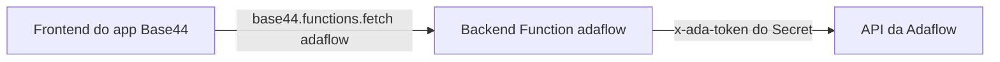

# Adaflow na Base44

Conecte um app da [Base44](https://base44.com) à Adaflow em cerca de 15
minutos, sem pedir nada à Adalink. Funciona em qualquer app com Backend
Functions, o que na Base44 pede o plano **Builder ou superior**.

O app passa a:

- conversar com especialistas e modelos da Adaflow, com resposta em streaming;
- executar agentes autônomos;
- listar especialistas, agentes, modelos e repositórios de conhecimento;
- registrar eventos na trilha de governança da organização.

## Como funciona



O frontend nunca vê o token. Ele chama a Backend Function `adaflow`, que
confere se o usuário está logado no app, lê o token nos Secrets e chama a
Adaflow. A função aceita só sete ações fechadas, valida os parâmetros e devolve
mensagens de erro em português, sem detalhe técnico.

## Passo a passo

### 1. Crie um token de app na Adaflow

O token age em nome de quem o criou, com as permissões dessa pessoa. Crie-o com
um **usuário de serviço** dedicado ao app, com o menor papel que dê acesso aos
especialistas e agentes que o app vai usar. Não use o token de um
administrador.

A criação é pela API (`POST /v1/gateway/app-tokens`), descrita no
[guia de apps integrados](../../docs/INTEGRATED-APPS-GUIDE.md). Guarde o valor:
ele aparece uma vez só.

### 2. Cadastre os Secrets no app

Nos Secrets do app, pelo painel do editor ou pelo CLI
(`npx base44 secrets set ADAFLOW_APP_TOKEN=...`):

| Secret | Obrigatório | Valor |
|---|---|---|
| `ADAFLOW_APP_TOKEN` | Sim | O token do passo 1 |
| `ADAFLOW_APP_SLUG` | Não | Nome do app na trilha de governança, por exemplo `portal-vendas`. Padrão: `base44-app` |
| `ADAFLOW_BASE_URL` | Não | Só para gateway private label. Vazio usa `https://zeus.adalink.app` |
| `ADAFLOW_ALLOW_ANONYMOUS` | Não | `true` libera visitantes sem login. Cada chamada consome créditos da organização, então deixe vazio salvo se o app for público de propósito |

### 3. Adicione a Backend Function

Com o CLI da Base44, copie a pasta [`functions/adaflow`](./functions/adaflow)
para `base44/functions/adaflow` no projeto e publique:

```bash
npx base44 functions deploy adaflow
```

Sem o CLI, cole o prompt de instalação ([`../prompts/base44.md`](../prompts/base44.md))
no chat do editor. Ele pede ao builder para criar a função `adaflow` com o
conteúdo de [`entry.ts`](./functions/adaflow/entry.ts), que é um arquivo único
de propósito.

### 4. Teste a conexão

No console do navegador, com o app aberto e logado:

```js
const res = await base44.functions.fetch('/adaflow', {
  method: 'POST',
  headers: { 'Content-Type': 'application/json' },
  body: JSON.stringify({ action: 'listSpecialists', limit: 5 }),
});
console.log(res.status, await res.json());
```

`200` com a lista de especialistas confirma tudo. Os erros mais comuns:

| Resposta | Causa |
|---|---|
| `500 not_configured` | Falta o secret `ADAFLOW_APP_TOKEN` |
| `401 login_required` | Ninguém logado no app |
| `401 adaflow_auth` | Token inválido ou revogado |
| `403 adaflow_forbidden` | O usuário de serviço não tem a permissão |
| `429 insufficient_quota` | Organização sem créditos |

### 5. Use no app

Peça ao builder o que você quer construir, por exemplo "uma tela de chat com o
especialista Jurídico usando a função adaflow". O prompt de instalação já
explica a função ao builder; os exemplos abaixo são a referência.

### Opcional: MCP no chat do editor

Para o chat de IA da Base44 conhecer seus especialistas e agentes enquanto
gera o app, conecte o MCP da Adaflow nas conexões MCP da sua conta:

- URL: `https://adaflow-mcp.adalink.app/mcp`
- Credencial: o mesmo token de app, no header `x-ada-token` ou como Bearer
  token

O MCP só atua durante a geração. O app publicado continua chamando a Adaflow
pela Backend Function `adaflow`. Detalhes no [guia do MCP](../mcp/README.md).

## Ações da função

Sempre `POST` com JSON. Toda resposta de erro tem o formato
`{ "error": { "code", "message" } }`, e `message` pode ir direto para a tela.

| `action` | Parâmetros | Resposta |
|---|---|---|
| `listSpecialists` | `page?`, `limit?`, `search?` | `{ items, total, page, limit, totalPages }` |
| `listAgents` | `page?`, `limit?`, `search?` | `{ data, total, page, limit }` |
| `listModels` | nenhum | `{ data: [{ id }] }` |
| `listRepositories` | `page?`, `limit?`, `search?` | `{ items, total, page, limit, totalPages }` |
| `chat` | `specialistId` ou `model`, `messages`, `chatId?`, `temperature?`, `maxTokens?`, `stream?` | Formato OpenAI. Header `x-chat-id` com o id da conversa |
| `runAgent` | `agentId`, `input`, `threadId?`, `stream?` | Execução (`status`, `output`) ou SSE |
| `trackEvents` | `events` (1 a 50) | `{ accepted, duplicated, rejected }` |

### Chat com especialista, em streaming

```js
async function perguntar(specialistId, texto, chatId, onToken) {
  const res = await base44.functions.fetch('/adaflow', {
    method: 'POST',
    headers: { 'Content-Type': 'application/json' },
    body: JSON.stringify({
      action: 'chat',
      specialistId,
      chatId, // undefined no primeiro turno
      messages: [{ role: 'user', content: texto }],
      stream: true,
    }),
  });
  if (!res.ok) throw new Error((await res.json()).error.message);

  const novoChatId = res.headers.get('x-chat-id'); // guarde para o próximo turno
  const reader = res.body.getReader();
  const decoder = new TextDecoder();
  let buffer = '';
  for (;;) {
    const { done, value } = await reader.read();
    if (done) break;
    buffer += decoder.decode(value, { stream: true });
    const eventos = buffer.split('\n\n');
    buffer = eventos.pop();
    for (const evento of eventos) {
      const dado = evento.replace(/^data: /, '');
      if (dado === '[DONE]') return novoChatId;
      const token = JSON.parse(dado).choices[0]?.delta?.content;
      if (token) onToken(token);
    }
  }
  return novoChatId;
}
```

Com `chatId`, a Adaflow guarda o histórico: nos turnos seguintes envie só a
mensagem nova.

### Agente autônomo

```js
const res = await base44.functions.fetch('/adaflow', {
  method: 'POST',
  headers: { 'Content-Type': 'application/json' },
  body: JSON.stringify({ action: 'runAgent', agentId, input: 'Resuma os pedidos de hoje' }),
});
const execucao = await res.json(); // { status: 'completed', output: '...' }
```

A execução síncrona pode levar minutos. Para mostrar o progresso, use
`stream: true` e leia o SSE como no chat.

### Governança

```js
await base44.functions.fetch('/adaflow', {
  method: 'POST',
  headers: { 'Content-Type': 'application/json' },
  body: JSON.stringify({
    action: 'trackEvents',
    events: [{ action: 'app.pedido.aprovado', resource: 'Pedido', metadata: { pedido: '1234' } }],
  }),
});
```

O nome do app vem do secret `ADAFLOW_APP_SLUG`, não do navegador. `action`
segue o formato `app.<domínio>.<verbo>`. Nunca ponha dados pessoais em
`metadata`.

## Alternativa: Custom OpenAPI integration

Para chamadas sem streaming, o admin do workspace pode importar a
[spec OpenAPI](../openapi/adaflow.yaml) como Custom OpenAPI integration, na
área de integrações do workspace, com o slug `adaflow` e o token como header
`x-ada-token`. Os apps do workspace
chamam com `base44.integrations.custom.call('adaflow', 'get:/v1/specialists')`.

A Backend Function continua sendo o caminho recomendado: ela faz streaming,
exige usuário logado e fixa o app da governança. A integração OpenAPI vale para
quem quer o mesmo token em vários apps do workspace e não precisa de streaming.

## Limites conhecidos

- **Auditoria e SSO:** com token de app, tudo o que o app faz aparece na
  Adaflow em nome do usuário de serviço. O login com o usuário real (SSO) não
  vale no preview nem em domínios da Base44 (`*.base44.app`): esses domínios
  são compartilhados por todos os usuários da plataforma, e a Adaflow só
  entrega o login a apps publicados na nuvem Adalink (`adalink.ai` ou
  `adalink.app`). Na Base44, use sempre o token de app.
- **Origem:** a função envia `x-ada-client: base44`, mas a plataforma só
  reconhece esse valor depois de incluí-lo na lista de apps conhecidos. Até
  lá, a chamada aparece como origem `unknown`.
- **Escopo do token:** o token ainda não aceita escopo por recurso. Ele vale
  para tudo o que o usuário de serviço pode fazer.
- **Dados fora do Brasil:** as chamadas passam pelo backend da Base44 antes de
  chegar à Adaflow. Clientes com exigência de soberania de dados devem evitar
  dados pessoais no conteúdo das mensagens.
